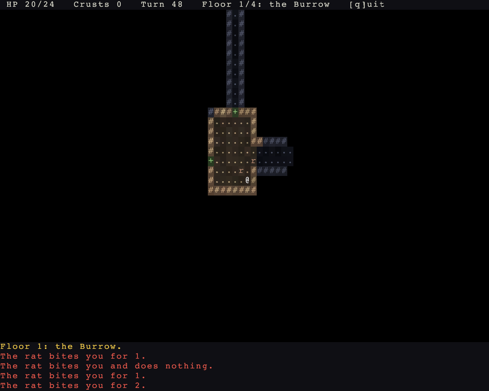

# atglyph: a roguelike engine for Rust and Bevy

[](https://github.com/rudehn/rl-engine/actions/workflows/ci.yml)
[](#license)
[](https://www.rust-lang.org)
[](https://bevyengine.org)

**atglyph** is an open source engine for turn-based, grid-based roguelike games, written in Rust on the Bevy game engine.
It gives you procedural dungeon and world generation, field of view, A* pathfinding, Dijkstra maps, monster AI, combat, items, quests and save games as small tested crates you depend on, not code you copy.
The core algorithms have no Bevy dependency, so map generation, pathfinding and game rules run headless, test in milliseconds and build for WebAssembly.



## Start here

The quickest start is the template, one file that plays from the first build:

```sh
cargo install cargo-generate
cargo generate --git https://github.com/rudehn/rl-engine --tag v0.3.0 templates/starter --name my-game
cd my-game
cargo run
```

The first run is a dark floor of rooms lit by your torch and a few braziers, goblins that notice you and hunt you, blows traded by walking into them, and potions, a dagger and a leather coat to pick up, drink and wear.
It is one file, with a status row, a log, a look cursor, and tests that play it without a window.
`--tag` fetches the template as it was at that release, and the generated game's `atglyph = "..."` line is the engine version it pins, so moving to a newer engine is changing that version; leave the tag off and the template comes from `main`, which may use something no release has yet.
CI generates and builds the template on every change to the engine, so it does not rot.

To try the engine first, the guide's first six steps run in the browser with nothing to install: [a map and walking](https://rudehn.github.io/rl-engine/01-a-map-and-walking.html), [sight and light](https://rudehn.github.io/rl-engine/02-sight-and-light.html), [blows and the log](https://rudehn.github.io/rl-engine/03-blows-and-the-log.html), [things and minds](https://rudehn.github.io/rl-engine/04-things-and-minds.html), [a knack](https://rudehn.github.io/rl-engine/05-a-knack.html) and [two floors](https://rudehn.github.io/rl-engine/06-two-floors.html).

## Features

- **Procedural map generation**: a chain of seeded passes with rooms and corridors, BSP, cellular automata caves, doors, largest-region cleanup and ASCII prefabs.
- **Places grown by accretion**: rooms, halls and passages attached piece by piece so they share walls, districts that differ across one map, loops cut through the longest detours, a survey of every area (dead end, chokepoint, junction, how far off the direct route), and recipes in RON that a place is held to and rebuilt until it meets.
- **Field of view**: symmetric shadowcasting over any `OpacitySource`, plus line of fire and targeting shapes for bolts, balls, beams and cones.
- **Pathfinding**: A* with reusable scratch buffers, region-bounded Dijkstra maps, flee maps and flow fields per movement profile.
- **Monster AI**: tactic-priority brains with hunt, melee, flee-when-hurt, wander, using what is carried, following a leader and exploring by a chart of what has been seen that a party shares and can hand on, reading snapshots of what each actor can see; a monster can answer its own moments too, a bite that poisons, a death that bursts, an aura that spares its bearer.
- **Work across many turns**: an actor rebuilding, charging or digging over turns it spends one at a time, broken off when it is hurt, dies or loses its reach, with its row saying what it is doing and how long it has left, so a busy actor never reads as a stuck one.
- **A turn loop the engine owns**: an integer-clock energy scheduler, speed-scaled action costs and every due turn resolved inside one frame.
- **A run nobody plays**: an onlooker in place of a player, a sight that sees the whole map, and a pace that deals so much game time a second, so two sides of minds fight while someone watches, or a thousand fights run headless.
- **RPG rules**: stats and modifiers, a staged damage pipeline with resistances, status effects that tick by the turn, hold an actor's turns, change its speed or hold it asleep until harm, a noise or a noticed foe wakes it, factions, equipment slots, item levels written as authored parts a game types its own items with, blows that sweep round the wielder or pierce through the target, sneak attacks on whoever has not noticed the attacker, and a to-hit roll shaped by range and light whose model is the game's to choose.
- **Items that do things**: the ground, bags and slots with stacks and tags, one `Loadout` summed from what an actor is and wears so nothing is copied onto a wearer, gear that grants stats, triggers that say in RON what a thing does when it is used, lands, fires or hits, a use aimed by the abilities' own cursor and rule or made on another thing chosen from the bag, charges that are spent and can refill, ammunition a shot spends from the bag, and throwing with the flight the resolver and the preview both read.
- **Identification and curses**: a thing not yet known shows its name and nothing it is worth on every screen while it does what it does, and a cursed thing refuses every way of coming off, each a marker the game puts on and takes off by its own rules.
- **Loot the engine places**: a floor scattered when a place is first built, drops rolled where the dead fall, and containers that ask for a kind of thing by tag and draw it at the band they stand on, so one locker holds better gear deeper; every draw from a stream of its own, and every item made by the game through one trait, since what an item is stays the game's.
- **Prefabs as data**: a piece of a place written in RON as rows of glyphs and a legend, one thing to a cell, with slots for props, for items named or drawn by tag and for monsters named or drawn by role from the game's own spawn table, each drawn at the depth of the place it was stamped in from a stream of its own cell, and a monster put at a slot holding it as its post, walking back when it has nothing better to do; a coverage report says, for every drawn slot at every depth, whether it finds something.
- **Abilities and targeting**: what an actor can spend a turn on as data in RON, with costs against a pool, health or a tagged item, requirements over statuses, slots and stats, cooldowns on the turn clock, effects as types a game extends, and one cursor that previews through the call the resolver lands with.
- **Stealth and awareness**: a roll to notice by sight and light, memory of who has noticed whom, waking on a blow, and minds that act only on what they have noticed and search where they last saw it, and statuses that make their holder unseen until it strikes.
- **Noise and hearing**: every engine action makes its own sound, loudness spent walking through what a tile is made of, and a listener that hears a place rather than who made it and walks to it as a trail.
- **Fire and gas**: a value per tile stepped a turn at a time, gas whose kinds are a game's content and fire whose rules are the engine's, both writing into what stops sight and light.
- **Props and remains**: a crate, a lever or a console as content rather than a component and an action in every game, containers with a screen the engine runs end to end, an actor that offers a verb too, a captive to free or someone to talk to, and the dead left where they fell as the entity that died, which a game can stand back up as it was.
- **Names from syllables**: a file of name sets, pools of syllables and weighted patterns, every drawn name checked against libtcod's rejections and drawn again a bounded number of times, and never one a run has already given.
- **Data-driven content**: tiles, monsters, items, statuses and quests are registries loaded from RON files, with weighted spawn tables by depth band.
- **Quests and events**: facts about what happened, named counters, and quests as objectives over those facts with prerequisites and a victory condition.
- **Save and load**: file, memory and browser storage backends, a versioned save schema and entity remapping.
- **Lighting**: point sources cast through the same shadows as sight, one component for props, actors and items, fuel that burns down, dark sight, a viewshed cut to what is lit, and three bands, dark, dim and lit, that stealth and the to-hit roll read; opt-in per game, with ambient a value the game writes.
- **Glyphs or pictures**: a diffed glyph grid renderer, drawn in a font the game ships so it looks the same on every platform and in a browser, and a tileset that draws a picture in place of any glyph it names with nothing else changing, so one game is letters or sprites at the flick of a setting; a map view where every cell is its own shade of its tile, light colours the background as well as the glyph, flames flicker and water shimmers, and memory, the stairs and things last seen as well as the ground, fades to a cold blue; animations played from what the turns cued, with the turns held so a bolt is seen to arrive before it hurts; which cell and which map tile the mouse is over, in a window of any size; and a capture tool that plays keys and photographs the window.
- **UI you can take apart**: seventeen panels, each a view of plain data, a collector that refills it and a presenter you may replace or drop, with colours named as roles in a palette rather than written into a widget, a narrator that says what a turn did through a phrasebook a game rewords, and a controls screen built from the registry every key is declared in.
- **Settings a player keeps**: a registry a game adds its own choices to, a screen that lists them, and a file that remembers them between launches, with fullscreen declared by the engine and a glyph grid that is laid out for its window, so text is sharp windowed, maximized or filling the screen.
- **A title screen**: the engine's menu over a game's own picture, holding the first run back until the player picks Continue, New Game, Records, Settings or Exit, asking before a saved run is given up, and offered again from the pause and end menus, with a run left there written down to be continued.
- **Records of every run**: a run ends in a record in the game's own words, a score, a line and its sections, filed best first and a hundred deep, kept between launches, and shown on the screen the run ends on and on a records screen the title opens.
- **Telling a run afterwards**: keys written down as they are played and pressed again against the clock they were read at, and a screen the run ends on with the outcome, the seed, the turn and whatever the game has to say about it.
- **Deterministic seeds**: one run seed, named random streams per domain and per pass, and no hash containers in gameplay code, so a seed replays the same map.
- **Balance tooling**: threat scoring and a spawn-band report over a game's own spawn table.

## Two ways to use it

The engine is split so you can take the rules without taking the loop.

### The toolkit

`atglyph-core`, `atglyph-grid`, `atglyph-mapgen` and `atglyph-rules` contain no Bevy and build for the browser.
They play the part bracket-lib plays: grids, field of view, light, pathfinding, chains of map generation passes, content registries from RON, and the rules a roguelike runs on, which are combat, statuses, charges and AI tactics.
Each is a plain function a game calls from a loop it owns, and each is tested with no `App`.
A few of them: `atglyph::rules::damage::{apply_hit, heal, mitigate}`, `atglyph::rules::faction::stance`, `atglyph::rules::arms::choose_reach`, `atglyph::rules::bump::resolve_bump`, `atglyph::rules::charges::spend`, `atglyph::rules::trade::quote`, `atglyph::rules::ai::awareness::observe`, `atglyph::grid::landing::landing`, `atglyph::grid::slide::slide` and `atglyph::primitives::turn::step_cost`.

Depend on those four crates and Bevy is never compiled.

`examples/terminal` is a walk through generated rooms in a terminal, built on `atglyph-core`, `atglyph-grid` and `atglyph-mapgen` alone, with `crossterm` for the keys and the screen.
Its `main.rs` only maps keys to steps, and the loop is the game's.

```sh
cargo run -p terminal   # arrows or hjklyubn to move, q, Esc or Ctrl-C to quit
```

### The framework

`atglyph-bevy`, `atglyph-render`, `atglyph-ui` and `atglyph-save`, behind the `atglyph` facade, own the loop: the turn order, the systems in a fixed sequence, the plugins, the panels and the saves.
A game adds `RoguelikePlugins` and then the subsystems it wants by name.
The tutorial, Undermere and Foundry are the worked examples.

### How the two meet

A framework system gathers what it needs from the world, calls a toolkit function, and applies the result.
So a rule behaves the same in either, and a game can start on the framework and drop to the toolkit wherever it wants different wiring.
To change the framework without forking it, leave out a plugin, join a system set, replace a presenter, or insert a resource of your own.

### What it does not do

It does not abstract over the ECS: the framework is Bevy's.
It does not need a window, though: a framework game plays in a text terminal, locally or over SSH, with `TtyRoguelikePlugins` in place of `RoguelikePlugins`, and the template runs that way with `cargo run -- --tty`.

## Follow the guide

The guide builds a small roguelike called Warren, nine steps that each add one thing, the first six playable in the browser without installing anything.

```sh
git clone https://github.com/rudehn/rl-engine
cd rl-engine
cargo run -p tutorial --bin step01_walking
```

Read it at [rudehn.github.io/rl-engine](https://rudehn.github.io/rl-engine/), or in [`docs/guide/src`](docs/guide/src), or run `mdbook serve docs/guide` for a local copy with search.

## Add it to a project you already have

Depend on it by version, as the template does.
The `atglyph` crate is the facade that re-exports every other crate, and `atglyph::prelude::*` brings in what a game reaches for, alongside `bevy::prelude::*`.

```toml
[dependencies]
atglyph = "0.3.0"
bevy = "0.19"
```

A game starts from `RoguelikePlugins`: a window sized to the glyph terminal, the engine's loop, sight, the map and the UI base.
Everything else is a plugin you name, so this is a game with combat and nothing it did not ask for.

```rust,no_run
use bevy::prelude::*;
use atglyph::prelude::*;

App::new()
    .add_plugins(RoguelikePlugins::new("My roguelike", 80, 40))
    .add_plugins((CombatPlugin, MindsPlugin))
    .run();
```

That compiles and opens a window, and then play refuses to begin until the game supplies a map, tile looks and a player, which the engine says at startup by listing everything missing at once.
The template is the smallest version that actually plays, and [the guide's first chapter](docs/guide/src/01-a-map-and-walking.md) writes it out line by line.

A tool or a server that needs no window can depend on a single tier-1 crate, such as `atglyph-grid` for field of view and pathfinding, and never compile Bevy.

```toml
[dependencies]
atglyph-grid = "0.3.0"
```

This builds a dungeon floor from a seed, computes what is visible from the start, and finds the path to the exit, all without Bevy.

```rust
use atglyph::primitives::RunSeed;
use atglyph::grid::{AStar, BitGrid, PathRules, TileRegistry, fov};
use atglyph::mapgen::dungeon::{ExitPoint, FarthestExit, RandomStart, Rooms};
use atglyph::mapgen::passes::StartPoint;
use atglyph::mapgen::{BaseContext, Chain};

// A 60 by 40 map of solid wall, with the standard wall and floor tiles.
let tiles = TileRegistry::standard();
let (wall, floor) = (tiles.expect("wall"), tiles.expect("floor"));
let mut map = BaseContext::blank(60, 40, tiles, wall);

// Carve rooms, place the start, and put the exit as far from it as possible.
// The same seed always builds the same floor.
Chain::new()
    .then(Rooms { floor, ..Default::default() })
    .then(RandomStart)
    .then(FarthestExit)
    .run(&mut map, RunSeed(7))
    .expect("a floor with rooms");
let start = map.outputs().first::<StartPoint>().unwrap().0;
let exit = map.outputs().first::<ExitPoint>().unwrap().0;

// Field of view from the start, and the cheapest walk to the exit.
let view = map.terrain().view(map.tiles());
let mut seen = BitGrid::new(60, 40);
fov::compute(&view, start, 8, &mut seen);
let path = AStar::new().find(&view, start, exit, PathRules::default()).expect("rooms connect");
println!("{} cells in sight, the exit is {} steps away", seen.count(), path.steps.len());
```

The two example games below are what to read once you know which subsystem you are looking for, and every mechanic the engine has is in one of them.
`examples/foundry/src/decks.rs` grows every deck of a run in one file.

## If the build fails

On Linux, Bevy needs a few system packages that a Rust toolchain does not bring.
On Debian and Ubuntu:

```sh
sudo apt install pkg-config libasound2-dev libudev-dev libwayland-dev libxkbcommon-dev
```

## Crates

The engine is a workspace of small crates in tiers.
Tiers 0 and 1 know nothing about Bevy and are what make generation, pathfinding and rules testable in milliseconds and benchmarkable without a window.
Tier 2 is the Bevy layer: plugins, the turn loop, rendering, UI.
Each crate declares its tier in its `Cargo.toml`, and `scripts/check-tiers.sh` fails the build if a tier-0 or tier-1 crate ever grows a Bevy dependency or any crate depends on a higher tier.

| Tier | Crate | What it holds |
|---|---|---|
| 0 | `atglyph-core` | grid, geometry, seeds and streams, dice, typed ids, the turn queue |
| 1 | `atglyph-grid` | tile registry, terrain, FOV, A*, Dijkstra maps, spatial index, regions |
| 1 | `atglyph-mapgen` | the pass pipeline and the builders that run in it |
| 1 | `atglyph-rules` | registries and banded tables from RON, stats, damage, statuses, factions, equipment, authored item parts, monster AI, facts and quests, balance scoring |
| 2 | `atglyph-bevy` | plugins, components, system sets, the turn loop, items, places |
| 2 | `atglyph-render` | the glyph grid renderer and the world view |
| 2 | `atglyph-save` | save backends, the versioned schema policy, entity remapping, the engine's state as a save |
| 2 | `atglyph-ui` | theme tokens, widgets, key hints, the log view |
| 3 | `atglyph` | facade and prelude |

## Example games

### Terminal, a walk through generated rooms

`examples/terminal` is the toolkit used alone: a walk through generated rooms on `atglyph-core`, `atglyph-grid` and `atglyph-mapgen`, with `crossterm` for the keys and a `main.rs` that only maps keys to steps.
Its tested functions are `terminal::{generate, step, look, render, direction_of}`.

```sh
cargo run -p terminal
```

### Foundry, a fight down a droid foundry

`examples/foundry` is a commando fighting down ten decks of a droid foundry, and the engine's worked example of combat depth: weapons that run hot or run dry, droids that shoot and raise the alarm, radar that an ion hit blinds, and a reactor charge that ends in a choice of upgrade.
It is a library with a thin binary, so its own tests and a fingerprint tripwire play the same game the window does.

```sh
cargo run -p foundry -- --seed 7
FOUNDRY_START=3 cargo run -p foundry -- --seed 7   # start on the reactor deck, for a screenshot
```

Keys: arrows, `hjklyubn` or the numpad to walk, `.` to wait, `>` `<` or Enter for the lifts, `f` to fire, `t` to throw a blade, `g` to pick up, `e` to set a charge beside the console, `L` to switch the shoulder lamp off or on, `i` for the pack, `a` for abilities, `x` to look, `tab` to pick out what is in sight, Escape for the menu, and `?` for all of them on one screen.

### Undermere, a delve under a lake

`examples/undermere` is a fantasy roguelike written to be a whole game rather than the worked example of one system, three parts in: the whole loop, thin, the items that make a run's builds, and the monsters that live on its floors.
A lakeside town, Mereholt, stands over the Drowned Gate, and under it ten floors of a sunken kingdom in five biomes go down to the Drowned King, whose death wins the run.
A monster is a core and a list of named traits in RON, an item lends traits to whoever wears it, and every floor is lit by its own ambient, its fixtures and the adventurer's lantern, which dims as they descend.
Things are its only progression: most are not known until used, scrolls of enchanting raise whatever the player reads them onto, heavy gear wants strength, a cursed thing clings once worn, and the armory runs from a dagger five times as hard on the unaware to staffs and wands zapped from the pack.
It opens on the engine's title over a painted night on the black lake, and every run ends in an itemized score, line by line, kept in the records the title opens.
Its map tiles are square, each two narrow cells wide, and it draws in a font it ships, DejaVu Sans Mono.

```sh
cargo run -p undermere -- --seed 7
UNDERMERE_START=5 cargo run -p undermere -- --seed 7   # start on floor five, for a screenshot
UNDERMERE_NEAR=camp cargo run -p undermere -- --seed 7 # walked up to a camp along the way, for a screenshot
```

Keys: arrows, `hjklyubn` or the numpad to walk, `.` to wait, `g` or `,` to pick up, `>` `<` or Enter for the stairs and the gate, `f` to shoot, `t` to throw from the pack, `i` for the pack, `x` to look, `tab` to pick out what is in sight, Escape for the menu, and `?` for all of them on one screen.

### Abilities in any genre

Abilities being data that serves any genre is proved by a test, not a game: `crates/atglyph-bevy/tests/genres.rs` loads a fantasy caster, a pirate, a marine, a man-at-arms and a thief into one registry from five RON files that differ in nothing but their words, and builds all eighteen against one set of effects.

### Pictures of your own

Any of the games photographs its own window when asked, after playing a script of keys through the real input:

```sh
ATGLYPH_CAPTURE=shot.png ATGLYPH_CAPTURE_KEYS="L j*4 l*6 ." cargo run -p foundry -- --seed 7

# Write a run down as it is played, and play it back.
ATGLYPH_RECORD=run.ron cargo run -p foundry -- --seed 7
ATGLYPH_REPLAY=run.ron cargo run -p foundry
```

The window opens above the others without taking focus, and the screen must be unlocked; a frame that comes back black is refused rather than saved.

## Design principles

- **Own the loop or leave it out.** A struct plus a `SystemSet` marker is not a subsystem.
- **No theme in the engine.** Content is an opaque id in a registry the game fills. No `#[non_exhaustive]` enums with a `Custom` variant, and no closed taxonomy enums.
- **Traits as parameters.** `impl Rng`, `impl CostSource`, `impl OpacitySource`, `impl Fn(Id) -> bool`. Asking the caller for a capability is how a Bevy dependency disappears.
- **Determinism within a build.** One `RunSeed`, named domains, per-pass streams, no hash containers in gameplay paths.
- **Measure the hot paths.** Every algorithm crate carries criterion benches on realistic maps.

## Documentation

[**docs/**](docs/) is the index of all of it. The short version:

- **[The guide](docs/guide/src/introduction.md)** builds a small roguelike in nine runnable chapters, from a map on screen to an action of your own. Start here, at [rudehn.github.io/rl-engine](https://rudehn.github.io/rl-engine/) for the sidebar and the search. Every chapter is a binary in `examples/tutorial`, so the code in the guide is code that compiles.
- **[The systems reference](docs/guide/src/systems/)** is the same book's page per subsystem, checked against the code it documents: what it is, its plugins, and where to read the source.
- [**docs/OVERVIEW.md**](docs/OVERVIEW.md) is the inventory of what exists and what is not built yet, kept current, with a table of every plugin and every panel.
- [**docs/design/**](docs/design/) is how one subsystem works and why, a page each for twenty-one of them, from abilities, fire and gas, lighting and minds to run records, stealth and the UI, listed in [the docs index](docs/README.md).
- [**docs/PLAN.md**](docs/PLAN.md) is the design: what was decided, why, and which milestone each piece lands in.
- [**docs/TODO.md**](docs/TODO.md) is the work that has been found and not started.
- [**docs/reviews/**](docs/reviews/) holds the code reviews of the three repos the engine was extracted from, with `path:line` citations for every claim in the plan.
- `cargo doc --open -p atglyph` builds the API reference; every public item is documented and every doc example runs as a test.

## Building and testing

```sh
cargo test -p atglyph-core -p atglyph-grid      # tier 0 and 1, seconds
cargo bench -p atglyph-grid                # FOV, A*, Dijkstra, regions
scripts/check-tiers.sh                # the tier boundaries
scripts/check-tiers.sh --wasm         # tiers 0 and 1, and atglyph-save, build for WebAssembly
scripts/check-guide.sh                # the guide's links into the code
mdbook serve docs/guide               # read the guide at localhost:3000
cargo test --workspace                # everything, builds Bevy
```

## Status

atglyph is pre-1.0 and its API still moves.
Two complete example games and the guide's own run on it, and CI checks formatting, clippy, tests, docs and the WebAssembly build of every tier-1 crate.

## License

Licensed under either of [Apache License, Version 2.0](LICENSE-APACHE) or [MIT license](LICENSE-MIT) at your option.

Unless you explicitly state otherwise, any contribution intentionally submitted for inclusion in this project by you, as defined in the Apache-2.0 license, shall be dual licensed as above, without any additional terms or conditions.
