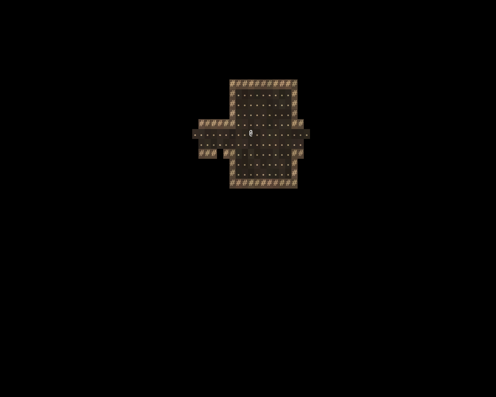

# A map, and walking on it

> Run it: `cargo run -p tutorial --bin step01_walking`
>
> Source: [`step01_walking.rs`](https://github.com/rudehn/rl-engine/blob/main/examples/tutorial/src/bin/step01_walking.rs)

<div class="demo" data-demo="step01_walking">
  
  <button type="button">Play this step</button>
  <p class="weight">Loads about 8 MB</p>
</div>

By the end of this chapter you have a window, a generated floor, and an `@` you can walk around it.

## The app

<!-- include: ../../../examples/tutorial/src/bin/step01_walking.rs:main -->
```rust,no_run
fn main() -> AppExit {
    App::new()
        // The window, the glyph terminal, the turn loop, sight, the map and
        // the UI base.
        .add_plugins(RoguelikePlugins::new("Warren", COLS, ROWS))
        // The game itself, the same plugin the tests add.
        .add_plugins(Warren)
        .insert_resource(Seed(RunSeed(7)))
        .run()
}
```

`RoguelikePlugins` opens an 80 by 40 cell window and brings the turn loop, field of view, the map view and the UI base.
`Seed` is where every random number comes from, so seed 7 always builds the same floor.

## The game is a plugin

<!-- include: ../../../examples/tutorial/src/bin/step01_walking.rs:plugin -->
```rust,no_run
/// The game: its floors, its start and its keys.
struct Warren;

impl Plugin for Warren {
    fn build(&self, app: &mut App) {
        let floors = Floors::new();
        app.insert_resource(floors.appearance()).places(floors);
        app.add_systems(NewRun, start);
        app.add_systems(Update, player_input.in_set(EngineSet::Input).run_if(no_modal));
        declare_controls(app);
    }
}
```

Everything Warren adds goes in this one plugin.
`main` adds it to a window, and the tests add the same plugin to a headless app, so they test the game you play.
Every later chapter adds lines here.

## Tiles

<!-- include: ../../../examples/tutorial/src/bin/step01_walking.rs:tiles -->
```rust,no_run
/// The warren's tiles: what each one is, and how it looks in full light.
struct Floors {
    tiles: TileRegistry,
}

impl Floors {
    fn new() -> Self {
        let mut tiles = TileRegistry::new();
        tiles.register(TileProps::wall("earth").look(TileLook::new('#', (0.78, 0.66, 0.50)).on((0.34, 0.27, 0.21)).vary(0.20, 0.05))).unwrap();
        tiles.register(TileProps::floor("dirt").look(TileLook::new('.', (0.66, 0.58, 0.45)).on((0.18, 0.15, 0.12)).vary(0.28, 0.06))).unwrap();
        // Walkable, but you cannot see through it.
        let roots = TileLook::new('+', (0.55, 0.74, 0.45)).on((0.16, 0.22, 0.13)).vary(0.18, 0.05);
        tiles.register(TileProps::floor("roots").opaque(true).look(roots)).unwrap();
        Self { tiles }
    }

    /// The renderer's colour table, from the looks the tiles carry.
    fn appearance(&self) -> TileAppearance {
        TileAppearance::from_tiles(&self.tiles).expect("every tile has a look")
    }
}
```

The engine has no built-in walls or floors.
You register your own, and each carries its look: a glyph, its colour, the cell's background, and how much each cell varies.
`roots` can be walked through but not seen through.
`TileAppearance::from_tiles` turns the looks into the renderer's colour table.

## Building a floor

<!-- include: ../../../examples/tutorial/src/bin/step01_walking.rs:rules -->
```rust,no_run
/// How a floor is built. The engine calls this the first time something
/// enters the floor, with that floor's own seed, and keeps the result.
impl PlaceRules for Floors {
    fn build(&self, _: MapId, seed: PlaceSeed) -> Result<PlaceBuild, BuildError> {
        let (wall, floor) = (self.tiles.expect("earth"), self.tiles.expect("dirt"));
        let mut ctx = BaseContext::blank(84, 42, self.tiles.clone(), wall);
        Chain::new()
            .then(dungeon::Rooms { floor, attempts: 40, min_size: 5, max_size: 10, min_rooms: 6 })
            .then(dungeon::Doors { door: self.tiles.expect("roots") })
            .then(dungeon::RandomStart)
            .run(&mut ctx, seed)?;
        PlaceBuild::from_context(ctx)
    }

    fn tiles(&self) -> TileTables {
        self.tiles.tables()
    }
}
```

`PlaceRules` is how a game builds its floors.
A `Chain` of passes carves the map: rooms, then doors of roots, then a starting cell.
The engine calls `build` the first time something enters the floor, and keeps the result.

## The player

<!-- include: ../../../examples/tutorial/src/bin/step01_walking.rs:start -->
```rust,no_run
/// Spawns the player at the first floor's start.
fn start(mut commands: Commands) {
    commands.spawn_player(MapId::FIRST, (Viewshed::new(9), RevealsMap, Glyph::new('@', Color::WHITE).on_layer(10)));
}
```

`start` runs in the `NewRun` schedule, once per run.
`spawn_player` puts the player at the floor's start.
`Viewshed` is how far it sees, and `RevealsMap` makes what it sees part of the map you remember.

## Keys

<!-- include: ../../../examples/tutorial/src/bin/step01_walking.rs:keys -->
```rust,no_run
/// Warren's own keys.
#[derive(Resource, Clone, Copy)]
struct Binds {
    quit: ControlId,
}

/// Declares the keys. Walking and waiting are the engine's standard keys.
fn declare_controls(app: &mut App) {
    app.add_plugins(PlayerKeysPlugin::new().walk("Move", "walk").wait("Act", "wait a turn"));
    let binds = Binds { quit: app.add_control("Game", "quit", KeyCode::KeyQ) };
    app.insert_resource(binds);
}
```

`PlayerKeysPlugin` reads the keys every roguelike shares: arrows, `hjklyubn` or the numpad to walk, `.` to wait.
A key press never moves anyone directly.
It becomes an intent, and the engine decides whether the move is legal and what it costs.

Your own keys are declared with `add_control`, which returns an id.
Keep the ids in a `Binds` resource and read them in a system:

<!-- include: ../../../examples/tutorial/src/bin/step01_walking.rs:input -->
```rust,no_run
/// Reads Warren's own keys once a frame.
fn player_input(keys: ControlInput, binds: Res<Binds>, mut exit: MessageWriter<AppExit>) {
    if keys.just_pressed(binds.quit) {
        exit.write(AppExit::Success);
    }
}
```

The system runs in `EngineSet::Input`, and only while no screen is open (`no_modal`), so a menu or a cursor gets the keys first.

## Try it

- Change `Viewshed::new(9)` to `4` and watch the room close in.
- Change the seed and you get a different floor; change it back and you get the same one.

Next: [what you can see, and the dark](02-sight-and-light.md).
