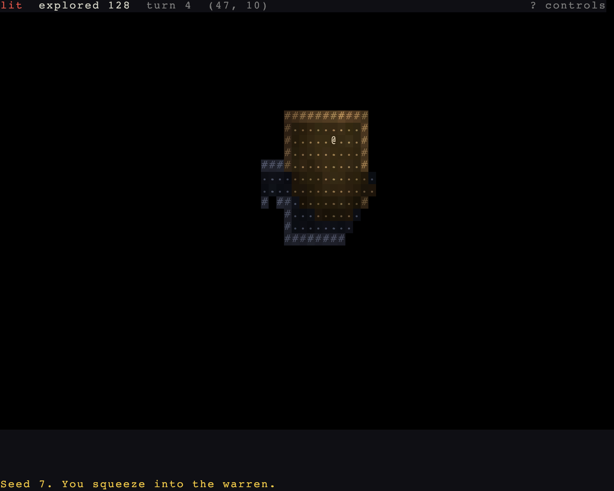

# What you can see, and the dark

> Run it: `cargo run -p tutorial --bin step02_light`
>
> Source: [`step02_light.rs`](https://github.com/rudehn/rl-engine/blob/main/examples/tutorial/src/bin/step02_light.rs)

<div class="demo" data-demo="step02_light">
  
  <button type="button">Play this step</button>
  <p class="weight">Loads about 8 MB</p>
</div>

The warren goes dark, and you carry the only light in it.
Two panels arrive to say what is going on, and Warren's tiles become its own.

## The app

<!-- include: ../../../examples/tutorial/src/bin/step02_light.rs:main -->
```rust,no_run
fn main() -> AppExit {
    let mut app = App::new();
    // What every game adds: the window and the glyph terminal, the turn
    // loop, sight, the map in everything but the status row and the log, and the UI base.
    app.add_plugins(RoguelikePlugins::new("Warren", COLS, ROWS).map(GridRect::new(0, 1, COLS, ROWS - 1 - LOG_ROWS)))
        // Without this the world is lit everywhere and sight is geometry
        // alone. With it, `visible` shrinks to what a light reaches.
        .add_plugins(LightingPlugin)
        .insert_resource(Lighting::dark())
        .insert_resource(Seed(RunSeed(7)))
        // Two panels: the vitals strip on the top row, the log along the
        // bottom. Each draws itself; neither needs a system of yours.
        .add_plugins(VitalsPanel::new(GridRect::new(0, 0, COLS, 1)).hints("[t]orch  [.]wait  [q]uit"))
        .add_plugins(LogPanel::new(GridRect::new(0, ROWS - LOG_ROWS, COLS, LOG_ROWS)))
        .add_systems(NewRun, start)
        // Once a frame, before the turns: the lantern is a key of Warren's
        // own, read beside the standard ones.
        .add_systems(Update, tend_lantern.in_set(EngineSet::Input))
        .add_systems(Update, note_explored.in_set(ViewSet::Annotate));
    // The floors, handed over once: the engine builds each the first time
    // something enters it, from that floor's own seed.
    let warren = Warren::new();
    app.insert_resource(warren.appearance()).places(warren);
    declare_controls(&mut app);
    app.run()
}
```

`LightingPlugin` is the subsystem that makes light matter, and `Lighting::dark()` turns the lights off.
Without them the world is lit everywhere and sight is geometry alone.

Two panels arrive here, and neither needs a system of yours.
`VitalsPanel` reads health, armor, the turn and the position off the player and prints them along the top row; `LogPanel` prints the log along the bottom.
Each is a plugin holding the rectangle it draws in, and `RoguelikePlugins::map` gives the map the rows between them.

From this step on `main` puts the game together itself, so the panels, the keys and the floors read in one place.
`places` hands over Warren's own floors, and their `TileAppearance` goes in beside them.

## Walkable and opaque are separate flags

<!-- include: ../../../examples/tutorial/src/bin/step02_light.rs:tiles -->
```rust,no_run
/// The warren's tiles, and how each one looks in full light.
struct Warren {
    tiles: TileRegistry,
}

impl Warren {
    fn new() -> Self {
        let mut tiles = TileRegistry::new();
        tiles.register(TileProps::wall("earth")).unwrap();
        tiles.register(TileProps::floor("dirt")).unwrap();
        // Walkable and opaque: you can step through a curtain of roots,
        // but you cannot see past one until you do.
        tiles.register(TileProps::floor("roots").opaque(true)).unwrap();
        Self { tiles }
    }

    /// Both colours of every tile, and how much each cell jitters from
    /// its neighbours. The renderer derives darkness and memory from these.
    fn appearance(&self) -> TileAppearance {
        let mut look = TileAppearance::new();
        let t = |name| self.tiles.expect(name);
        look.set_varied(t("earth"), Cell::new('#', Color::srgb(0.78, 0.66, 0.50)).on(Color::srgb(0.34, 0.27, 0.21)), Vary::new(0.20, 0.05));
        look.set_varied(t("dirt"), Cell::new('.', Color::srgb(0.66, 0.58, 0.45)).on(Color::srgb(0.18, 0.15, 0.12)), Vary::new(0.28, 0.06));
        look.set_varied(t("roots"), Cell::new('+', Color::srgb(0.55, 0.74, 0.45)).on(Color::srgb(0.16, 0.22, 0.13)), Vary::new(0.18, 0.05));
        look
    }
}
```

Warren leaves the standard tiles for three of its own, `earth`, `dirt` and `roots`.
`register` returns a dense `TileId`, and `expect` looks one up by name and panics if it is missing.
The `Doors` pass hangs a curtain of roots where a corridor meets a room.
A curtain is walkable and opaque: you can step through one, but you cannot see past it until you do.

`TileAppearance` holds what each id looks like in full light.
Both colours are authored because light multiplies them channel by channel and memory fades them.
`Vary` jitters each cell's colour by a hash of its position, so the floor is not graph paper.

Field of view reads opacity off the tile tables through an `OpacitySource`, so a tile you invented five minutes ago blocks sight correctly.

## Seen, and once seen

`Viewshed` carries two bit grids.
`line` is every tile with an unobstructed line to it, and `visible` is what the actor really sees.
They are the same set until lighting is on, when `visible` shrinks to what is lit, within dark sight, or adjacent.

`Knowledge` is the explored map, kept per map id and filled by whoever carries `RevealsMap`.
It is a resource, not a component: the player's map is the game's map.

The map view combines the three.
Visible tiles are drawn in their authored colours, explored-but-unseen ones run through `Memory`, and everything else is blank.
The cold blue of a remembered corridor is not a colour anyone chose.
It is the brown floor, remembered.

## What the panel cannot know

<!-- include: ../../../examples/tutorial/src/bin/step02_light.rs:status -->
```rust,no_run
/// The one thing the vitals panel cannot know: how much of the map is
/// ours. A note on the view, in the game's own words.
fn note_explored(mut vitals: ResMut<VitalsView>, knowledge: Res<Knowledge>) {
    vitals.facets.push(Facet::new("explored", format!("{} tiles explored", knowledge.explored_count())));
}
```

The vitals panel knows nothing of how much of the map you have explored.
A game says what a panel cannot know as a `Facet`, a key and its text, pushed onto the panel's view in `ViewSet::Annotate`, and the panel prints it with the rest.

## A light to carry

<!-- include: ../../../examples/tutorial/src/bin/step02_light.rs:lantern -->
```rust,no_run
/// What the lantern sheds when it is open: a warm, slightly restless pool.
const LANTERN: LightSource = LightSource::new(150, 7, Rgb::new(255, 210, 140)).flickering(30);

/// The player and whether its lantern is open, while it holds the turn.
type Lantern<'w, 's> = Query<'w, 's, (Entity, Has<LightSource>), (With<Player>, With<MyTurn>)>;

/// `t` opens the lantern or shades it, and spends the turn either way.
///
/// The light is a component on the player, so shading it is removing one.
/// Nothing else changes: sight is still sight, and the explored map still
/// remembers what the light once reached.
fn tend_lantern(keys: Res<ButtonInput<KeyCode>>, mut commands: Commands, player: Lantern, mut waits: MessageWriter<Intent<Wait>>, mut log: Log) {
    if !keys.just_pressed(KeyCode::KeyT) {
        return;
    }
    let Ok((entity, lit)) = player.single() else { return };
    if lit {
        commands.entity(entity).remove::<LightSource>();
        log.muted("You shade the lantern. The warren closes to arm's length.");
    } else {
        commands.entity(entity).insert(LANTERN);
        log.notice("You open the lantern. The dirt comes up warm around you.");
    }
    waits.write(Intent::new(entity, Wait));
}
```

A `LightSource` is a component, so shading the lantern is removing one and opening it is putting it back.
Either way the key writes a `Wait`, so tending the lantern spends the turn.

`Log` is how a system writes to the log: `notice`, `info`, `muted`, or `push` with a tone, each line stamped with the current turn.

Sight is unchanged by any of this.
What changes is which of the tiles in line are lit enough to resolve, which is why walking into the dark with the lantern shut still fills in the floor you are standing on.

Every actor has its own viewshed, cast the same way, so a monster that sheds no light is found only where a light reaches it.
That cuts both ways, and [chapter 3](03-blows-and-the-log.md) gives the rats dark sight so they can still find you.

## Try it

- Shade the lantern and walk a corridor. The explored map keeps what the light already reached.
- Change `LANTERN`'s radius from 7 to 2 and feel the warren close in.
- Give the lantern `Fuel` and watch it burn out.

Next: [blows, and the log that tells you](03-blows-and-the-log.md).
