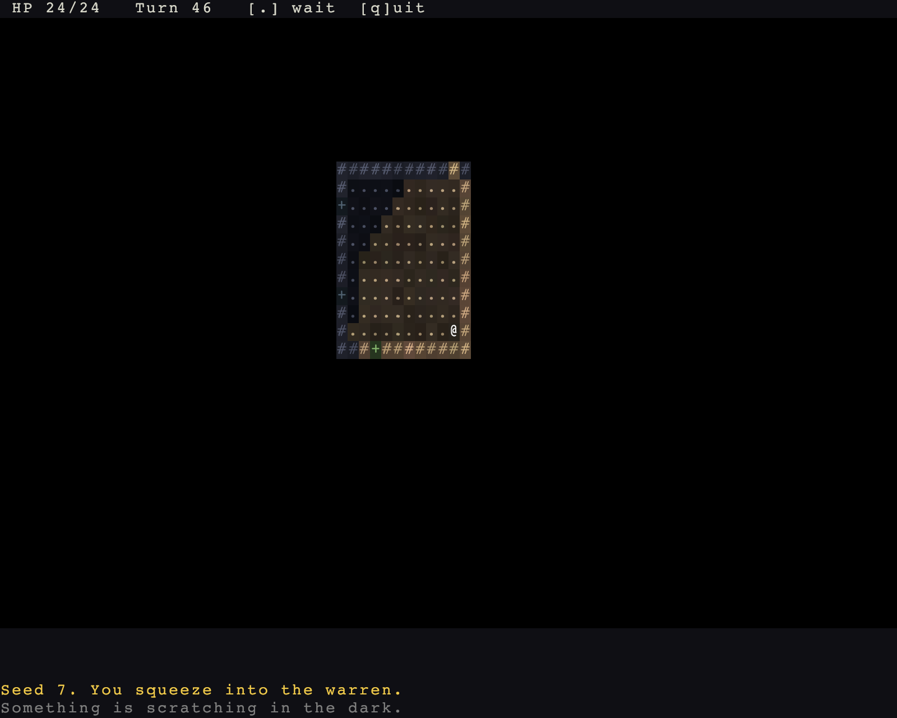

# Blows, and the log that tells you

> Run it: `cargo run -p tutorial --bin step03_blows`
>
> Source: [`step03_blows.rs`](https://github.com/rudehn/rl-engine/blob/main/examples/tutorial/src/bin/step03_blows.rs)

<div class="demo" data-demo="step03_blows">
  
  <button type="button">Play this step</button>
  <p class="weight">Loads about 8 MB</p>
</div>

Rats arrive, they bite, and you can kick back.
The log says who hit whom, and dying opens a menu.

## Combat and minds

<!-- include: ../../../examples/tutorial/src/bin/step03_blows.rs:plugin -->
```rust,no_run
/// The game: its floors, its start and its keys.
struct Warren;

impl Plugin for Warren {
    fn build(&self, app: &mut App) {
        let floors = Floors::new();
        app.insert_resource(floors.appearance()).places(floors);
        // Without lighting the world is lit everywhere. With it, you see
        // only what a light reaches.
        app.add_plugins(LightingPlugin).insert_resource(Lighting::dark());
        // Combat resolves blows; minds decide the monsters' turns.
        app.add_plugins((CombatPlugin, MindsPlugin));
        app.add_systems(NewRun, start);
        // Inside the turn: a floor fills the first time it is entered.
        app.add_systems(Turn, populate.in_set(TurnSet::React));
        app.add_systems(Update, (player_input, tend_lantern).in_set(EngineSet::Input).run_if(no_modal));
        // The vitals view is data the panel in `main` draws; the game writes
        // a line onto it, so the game adds it.
        app.add_plugins(VitalsViewPlugin).add_systems(Update, note_explored.in_set(ViewSet::Annotate));
        declare_controls(app);
    }
}
```

`CombatPlugin` resolves blows and `MindsPlugin` decides what monsters do on their turns.
Walking into a monster now attacks it: the walk key's intent becomes a step, a blow or opening a door, whichever fits.

## Damage kinds and sides

<!-- include: ../../../examples/tutorial/src/bin/step03_blows.rs:start -->
```rust,no_run
/// Hands combat its registries and the rats their brain, then spawns the
/// player at the first floor's start, lantern open.
fn start(mut commands: Commands, seed: Res<Seed>, mut log: Log) {
    // What damage can be, and who hates whom: the game's content, which
    // the engine knows only by id.
    let kinds = Registry::from_defs(vec![DamageKind::new("bite"), DamageKind::new("kick")]).unwrap();
    let sides = Registry::from_defs(vec![FactionDef::new("you"), FactionDef::new("vermin")]).unwrap();
    let (you, vermin) = (sides.expect("you"), sides.expect("vermin"));
    commands.insert_resource(CombatRules::new().hostile(you, vermin));
    commands.insert_resource(Registries { damage_kinds: kinds.clone(), factions: sides, ..default() });
    commands.insert_resource(Rats {
        // Asked in order, and the first that answers wins: bite what is
        // beside you, run when badly hurt, chase what you see, else wander.
        mind: Arc::new(Brain::new().then(MeleeAdjacent).then(FleeWhenHurt { at_pct: 30 }).then(Hunt).then(Wander { chance_pct: 40 })),
        bite: kinds.expect("bite"),
        faction: vermin,
    });

    commands.spawn_player(
        MapId::FIRST,
        (
            (Viewshed::new(9), RevealsMap, LANTERN, Faction(you), Glyph::new('@', Color::WHITE).on_layer(10)),
            (Health::full(24), Armor(1), MeleeAttack::new(kinds.expect("kick"), DiceRoll::new(1, 6))),
        ),
    );
    log.notice(format!("Seed {}. You squeeze into the warren.", seed.0.0));
    log.muted("Something is scratching in the dark.");
}
```

Combat needs two things from the game: what kinds of damage exist, and which sides are hostile.
Both are registries of your own names; the engine only sees ids.
The player gets health, armor and a kick, and a `Faction` to fight on.

## Rats

<!-- include: ../../../examples/tutorial/src/bin/step03_blows.rs:creatures -->
```rust,no_run
/// What every rat shares: one brain, one bite, one side.
#[derive(Resource)]
struct Rats {
    mind: Arc<Brain<Entity>>,
    bite: atglyph::rules::damage::DamageKindId,
    faction: FactionId,
}
```

A `Brain` is a list of tactics.
Each turn the engine asks them in order, and the first that has an answer wins.
Every rat shares one brain through an `Arc`.

<!-- include: ../../../examples/tutorial/src/bin/step03_blows.rs:populate -->
```rust,no_run
/// The random stream rats are placed from. Each floor draws it from its own
/// seed, so floors can be entered in any order.
const RATS: SeedDomain = SeedDomain::new(b"warren.rats");

/// Fills a floor the first time it is entered.
fn populate(mut commands: Commands, mut entered: MessageReader<PlaceEntered>, rats: Res<Rats>, map: Res<WorldMap>, seed: Res<Seed>) {
    for ev in entered.read() {
        if !ev.first {
            continue;
        }
        let Some(place) = map.place(ev.map) else { continue };
        let bounds = place.bounds();
        let mut rng = seed.place(ev.map).rng(RATS, 0);
        let mut placed = 0;
        while placed < 16 {
            let p = Point::new(rng.random_range(bounds.x..bounds.right()), rng.random_range(bounds.y..bounds.bottom()));
            // On floor, and not close enough to the start to be unfair.
            if !map.is_walkable(p) || geometry::chebyshev(p, ev.entry) < 8 {
                continue;
            }
            let mut rat = commands.spawn((
                (Actor, Blocks, Position(p), Speed(110), Faction(rats.faction)),
                (Health::full(6), Armor(0), Perception(7), DarkSight(9)),
                (MeleeAttack::new(rats.bite, DiceRoll::new(1, 3)),),
            ));
            rat.insert((Mind(rats.mind.clone()), Glyph::new('r', Color::srgb(0.72, 0.55, 0.45)).on_layer(5), Name::new("rat")));
            placed += 1;
        }
    }
}
```

`populate` runs in `TurnSet::React` when the player first enters a floor.
It draws positions from a stream of the floor's seed, so the same seed places the same rats.
A rat is a bundle of components: `Actor` takes turns, `Blocks` fills its cell, `Mind` decides.

## The narrator and the menu

<!-- include: ../../../examples/tutorial/src/bin/step03_blows.rs:narrator -->
```rust,no_run
/// The engine narrates blows and deaths into the log. Warren changes one
/// phrase: what a rat does to you is a bite.
fn narrator() -> NarratorPlugin {
    NarratorPlugin::default().phrase(Phrase::HitsYou, "{Who} bites you for {n}.", Tones::BAD)
}
```

`NarratorPlugin` writes blows and deaths to the log.
Warren rewrites one phrase, so a rat bites rather than hits.

<!-- include: ../../../examples/tutorial/src/bin/step03_blows.rs:main -->
```rust,no_run
fn main() -> AppExit {
    App::new()
        // The map now leaves the top row for the vitals and the bottom rows
        // for the log.
        .add_plugins(RoguelikePlugins::new("Warren", COLS, ROWS).map(GridRect::new(0, 1, COLS, ROWS - 1 - LOG_ROWS)))
        .add_plugins(Warren)
        .add_plugins((
            VitalsPanel::new(GridRect::new(0, 0, COLS - 13, 1)),
            LogPanel::new(GridRect::new(0, ROWS - LOG_ROWS, COLS, LOG_ROWS)),
            // `?` lists every key the game declared; the top-right corner
            // says so.
            ControlsPanel::new(GridRect::new(4, 3, COLS - 8, ROWS - LOG_ROWS - 6)).hint(GridRect::new(COLS - 13, 0, 12, 1)),
        ))
        .add_plugins(narrator())
        // Escape opens the menu, and dying opens it by itself.
        .add_plugins(GameMenuPanel::new(GridRect::new(COLS / 2 - 20, 8, 40, 12)).died("The warren keeps you."))
        .insert_resource(Seed(RunSeed(7)))
        .run()
}
```

`GameMenuPanel` opens on Escape, and by itself when you die, offering a new run.

## Try it

- Give the rats `Speed(200)` and see how fast they close in.
- Remove `FleeWhenHurt` from the brain and the rats fight to the death.

Next: [things to carry, throw and eat](04-things-and-minds.md).
