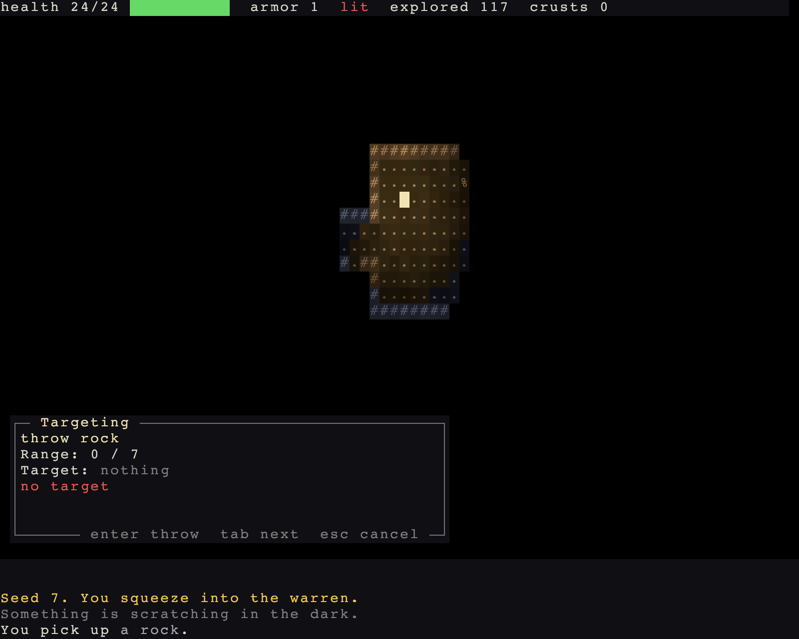

# Things to carry, throw and eat

> Run it: `cargo run -p tutorial --bin step04_things`
>
> Source: [`step04_things.rs`](https://github.com/rudehn/rl-engine/blob/main/examples/tutorial/src/bin/step04_things.rs)

<div class="demo" data-demo="step04_things">
  
  <button type="button">Play this step</button>
  <p class="weight">Loads about 8 MB</p>
</div>

The floor gets bread to eat and rocks to throw, and some of the rats get clever enough to throw rocks back.

## Items

<!-- include: ../../../examples/tutorial/src/bin/step04_things.rs:litter -->
```rust,no_run
/// A crust of bread, and how much it heals.
#[derive(Component, Clone, Copy)]
struct Crust(i32);

/// Drops a crust or a rock at `p`.
fn litter(commands: &mut Commands, rats: &Rats, p: Point, bread: bool) {
    if bread {
        commands.spawn((Item, Crust(8), Name::new("crust of bread"), Position(p), Glyph::new('%', Color::srgb(0.85, 0.72, 0.40)).on_layer(2)));
    } else {
        // Thrown up to 7 cells, for 1d4.
        let flies = Throwable::new(Some(7), Some((rats.bite, DiceRoll::new(1, 4))));
        commands.spawn((Item, flies, Name::new("rock"), Position(p), Glyph::new('*', Color::srgb(0.66, 0.66, 0.70)).on_layer(2)));
    }
}
```

An item is an entity with `Item` and a `Position`.
Picking one up moves it into an `Inventory`, which `ItemsPlugin` does when you press `g`; with nothing underfoot, `g` says the `Otherwise` it was declared with.
`Crust` is Warren's own component; `Throwable` is the engine's, with a range and a damage roll.
A range of `None` flies as far as the thrower reaches, which `CombatRules::reach` sets; a rock names its own.

## The plugins

<!-- include: ../../../examples/tutorial/src/bin/step04_things.rs:plugin -->
```rust,no_run
/// The game: its floors, its start and its keys.
struct Warren;

impl Plugin for Warren {
    fn build(&self, app: &mut App) {
        let floors = Floors::new();
        app.insert_resource(floors.appearance()).places(floors);
        // Without lighting the world is lit everywhere. With it, you see
        // only what a light reaches.
        app.add_plugins(LightingPlugin).insert_resource(Lighting::dark());
        // Combat resolves blows; minds decide the monsters' turns.
        app.add_plugins((CombatPlugin, MindsPlugin));
        // Items lie on the floor or in a bag; thrown ones fly. The target
        // view runs the aiming cursor that `main` draws.
        app.add_plugins((ItemsPlugin, ThrowingPlugin, TargetViewPlugin));
        app.add_systems(NewRun, start);
        // Inside the turn: a floor fills the first time it is entered, and
        // a crust heals before the next rat bites.
        app.add_systems(Turn, (populate, eat).in_set(TurnSet::React));
        app.add_systems(Update, narrate.in_set(PresentSet::Narrate));
        app.add_systems(Update, (player_input, tend_lantern).in_set(EngineSet::Input).run_if(no_modal));
        // The vitals view is data the panel in `main` draws; the game writes
        // a line onto it, so the game adds it.
        app.add_plugins(VitalsViewPlugin).add_systems(Update, (note_explored, note_bag).in_set(ViewSet::Annotate));
        declare_controls(app);
    }
}
```

`ThrowingPlugin` resolves throws.
`TargetViewPlugin` runs the aiming cursor: it picks a target, follows the arrow keys and Tab, and throws on Enter.

## Drawing the cursor

<!-- include: ../../../examples/tutorial/src/bin/step04_things.rs:target -->
```rust,no_run
        // Draws the aiming cursor: the flight, who it would hit, and a box
        // saying so. Without it the cursor still opens, unseen.
        .add_plugins(TargetPanel::new(GridRect::new(1, ROWS - LOG_ROWS - 9, 44, 8)).hints("enter throw  tab next  esc cancel"))
```

`TargetPanel` draws what the cursor would do: the flight, who it hits, and a box saying so, or why it can't.
Add it whenever you add `TargetViewPlugin`.
Without it the cursor still opens, unseen, and holds the arrow keys until you press Enter or Escape.

## Keys

<!-- include: ../../../examples/tutorial/src/bin/step04_things.rs:keys -->
```rust,no_run
/// Warren's own keys.
#[derive(Resource, Clone, Copy)]
struct Binds {
    eat: ControlId,
    throw: ControlId,
    lantern: ControlId,
    quit: ControlId,
}

/// Declares the keys. Walking and waiting are the engine's standard keys.
fn declare_controls(app: &mut App) {
    app.add_plugins(
        PlayerKeysPlugin::new()
            .walk("Move", "walk or attack")
            .pick_up("Act", "pick up what is here", Otherwise::say("There is nothing here."))
            .wait("Act", "wait a turn"),
    );
    let binds = Binds {
        eat: app.add_control("Act", "eat a crust", KeyCode::KeyE),
        throw: app.add_control("Act", "throw a rock", KeyCode::KeyR),
        lantern: app.add_control("Act", "lantern on or off", KeyCode::KeyT),
        quit: app.add_control("Game", "quit", KeyCode::KeyQ),
    };
    app.insert_resource(binds);
}
```

<!-- include: ../../../examples/tutorial/src/bin/step04_things.rs:input -->
```rust,no_run
/// The player, while it holds the turn, and its bag.
type PlayerTurn<'w, 's> = Query<'w, 's, (Entity, &'static Inventory), (With<Player>, With<MyTurn>)>;

/// Reads Warren's own keys once a frame. Asking to act is writing an
/// intent: the engine spends the turn, or refuses what cannot be done.
fn player_input(keys: ControlInput, binds: Res<Binds>, player: PlayerTurn, carried: Carried, mut intents: PlayerIntents, mut exit: MessageWriter<AppExit>) {
    if keys.just_pressed(binds.quit) {
        exit.write(AppExit::Success);
    }
    // Not the player's turn: drop the key.
    let Ok((entity, bag)) = player.single() else { return };
    if keys.just_pressed(binds.eat) {
        if let Some(crust) = bag.items.iter().copied().find(|i| carried.crusts.contains(*i)) {
            intents.uses.write(Intent::new(entity, UseItem(crust)));
        }
    } else if keys.just_pressed(binds.throw)
        && let Some(rock) = bag.items.iter().copied().find(|i| carried.rocks.contains(*i))
    {
        // Opens the aiming cursor. The engine writes the throw on Enter.
        intents.aims.write(AimThrow { user: entity, item: rock });
    }
}

/// Every intent Warren's keys write, in one parameter.
#[derive(bevy::ecs::system::SystemParam)]
struct PlayerIntents<'w> {
    uses: MessageWriter<'w, Intent<UseItem>>,
    aims: MessageWriter<'w, AimThrow>,
}

/// What the bag might hold, so a key can pick the right thing.
#[derive(bevy::ecs::system::SystemParam)]
struct Carried<'w, 's> {
    crusts: Query<'w, 's, (), With<Crust>>,
    rocks: Query<'w, 's, (), With<Throwable>>,
}
```

`e` writes an `Intent<UseItem>` for the first crust in the bag.
`r` writes `AimThrow`, which opens the cursor; the throw itself is written by the engine when you press Enter.
`SystemParam` structs keep the system's parameter list short as the game grows.

## Eating

<!-- include: ../../../examples/tutorial/src/bin/step04_things.rs:eat -->
```rust,no_run
/// What eating a crust does. The engine has spent the turn and taken the
/// crust out of the bag; healing is the game's part.
fn eat(mut commands: Commands, mut used: MessageReader<ItemEvent>, crusts: Query<&Crust>, mut eaters: Query<&mut Health>) {
    for ev in used.read() {
        let ItemEvent::Used { actor, item } = *ev else { continue };
        let (Ok(crust), Ok(mut health)) = (crusts.get(item), eaters.get_mut(actor)) else { continue };
        health.current = (health.current + crust.0).min(health.max);
        commands.entity(item).despawn();
    }
}

/// The log line for eating. Blows, deaths and pickups the engine narrates.
fn narrate(mut items: MessageReader<ItemEvent>, mut log: Log) {
    for ev in items.read() {
        if let ItemEvent::Used { .. } = *ev {
            log.push("You eat the crust. It helps.", Tones::GOOD);
        }
    }
}

/// Adds a line to the vitals panel: how many crusts you carry.
fn note_bag(mut vitals: ResMut<VitalsView>, player: Query<&Inventory, With<Player>>, crusts: Query<(), With<Crust>>) {
    let Ok(bag) = player.single() else { return };
    let count = bag.items.iter().filter(|i| crusts.contains(**i)).count();
    vitals.facets.push(Facet::new("crusts", format!("crusts {count}")));
}
```

The engine spends the turn and takes the crust out of the bag; what eating does is the game's.
`eat` runs in `TurnSet::React`, inside the turn, so the healing lands before the next rat bites.
`narrate` writes the log line, and `note_bag` counts your crusts on the status row.

## Ratlings

<!-- include: ../../../examples/tutorial/src/bin/step04_things.rs:populate -->
```rust,no_run
/// The random stream rats are placed from. Each floor draws it from its own
/// seed, so floors can be entered in any order.
const RATS: SeedDomain = SeedDomain::new(b"warren.rats");

/// Fills a floor the first time it is entered.
fn populate(mut commands: Commands, mut entered: MessageReader<PlaceEntered>, rats: Res<Rats>, map: Res<WorldMap>, seed: Res<Seed>) {
    for ev in entered.read() {
        if !ev.first {
            continue;
        }
        let Some(place) = map.place(ev.map) else { continue };
        let bounds = place.terrain.bounds();
        let mut rng = seed.place(ev.map).rng(RATS, 0);
        let mut placed = 0;
        while placed < 16 {
            let p = Point::new(rng.random_range(bounds.x..bounds.right()), rng.random_range(bounds.y..bounds.bottom()));
            // On floor, and not close enough to the start to be unfair.
            if !map.is_walkable(p) || geometry::chebyshev(p, ev.entry) < 8 {
                continue;
            }
            // Every fourth is a ratling: the same body, a cleverer mind.
            let clever = placed % 4 == 3;
            let mut rat = commands.spawn((
                (Actor, Blocks, Position(p), Speed(110), Faction(rats.faction)),
                (Health::full(6), Armor(0), Perception(7), DarkSight(9)),
                (MeleeAttack::new(rats.bite, DiceRoll::new(1, 3)),),
            ));
            if clever {
                rat.insert((
                    Mind(rats.ratling.clone()),
                    // Wits say what a mind may consider: a ratling opens
                    // doors, picks things up and throws them.
                    Intelligence(Wits::SAPIENT),
                    Inventory::default(),
                    Glyph::new('R', Color::srgb(0.85, 0.66, 0.50)).on_layer(5),
                    Name::new("ratling"),
                ));
            } else {
                rat.insert((Mind(rats.mind.clone()), Intelligence(Wits::ANIMAL), Glyph::new('r', Color::srgb(0.72, 0.55, 0.45)).on_layer(5), Name::new("rat")));
            }
            placed += 1;
        }
        // Bread and rocks, scattered the same way.
        let mut dropped = 0;
        while dropped < 14 {
            let p = Point::new(rng.random_range(bounds.x..bounds.right()), rng.random_range(bounds.y..bounds.bottom()));
            if map.is_walkable(p) {
                litter(&mut commands, &rats, p, dropped % 2 == 0);
                dropped += 1;
            }
        }
    }
}
```

A ratling is a rat with a different brain and different `Intelligence`.
`Wits::SAPIENT` lets its mind open doors, pick things up and throw them; `Wits::ANIMAL` does not.
Its brain, built in `start` beside the rat's, adds `Scavenge` to fetch a rock and `ThrowAtRange` to throw it.

## Try it

- Pick up a rock with `g`, press `r`, Tab to a rat, and Enter.
- Make every rat a ratling.

Next: [a knack of your own](05-a-knack.md).
