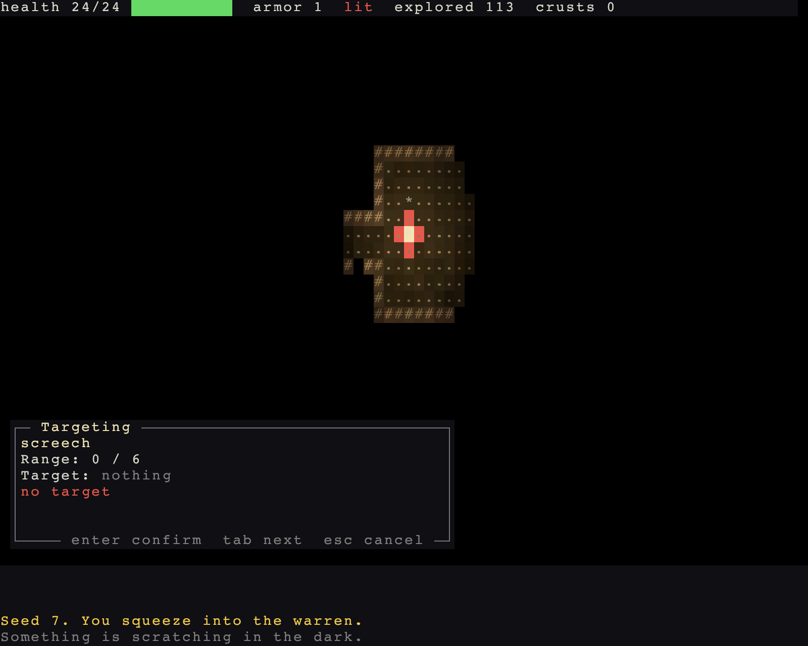

# A knack of your own

> Run it: `cargo run -p tutorial --bin step05_knack`
>
> Source: [`step05_knack.rs`](https://github.com/rudehn/rl-engine/blob/main/examples/tutorial/src/bin/step05_knack.rs)

<div class="demo" data-demo="step05_knack">
  
  <button type="button">Play this step</button>
  <p class="weight">Loads about 8 MB</p>
</div>

You get a screech that hurts every rat in a small burst, and ratlings learn to eat the crust they carry.

## An ability is data

<!-- include: ../../../examples/tutorial/assets/knacks.ron -->
```ron
// The one knack the warren gives you.
//
// Every field (the ones marked "optional" may be left out):
//   name:        unique; what the game looks it up by
//   description: optional; what it is, in a sentence, for the knack list
//   look:        optional; (glyph:, color: (r:, g:, b:)), what flies and bursts
//   aim:         Foe (default) | Ally | SelfOnly | Ground | Anyone
//   mode:        Own | Adjacent | Bolt(range:) | Ball(range:, radius:) |
//                Beam(range:) | Cone(length:)
//   costs:       optional; this one costs no pool, only the wait
//   cooldown:    optional; hundredths of a step before it may be used again
//   effects:     each (kind:, chance:, args:); "Harm" takes a damage kind
//                this game registered and a dice roll
#![enable(implicit_some)]
[
    (
        name: "screech",
        description: "A shriek that goes through a rat like a nail. It carries, and it hurts.",
        look: (glyph: '*', color: (r: 220, g: 220, b: 255)),
        aim: Foe,
        mode: Ball(range: 6, radius: 1),
        cooldown: 300,
        effects: [(kind: "Harm", args: (kind: "din", roll: "1d6"))],
    ),
    (
        name: "gnaw",
        description: "Eat the crust you are carrying. A ratling knows to do this; a rat does not.",
        aim: SelfOnly,
        mode: Own,
        costs: [Item("bread", 1)],
        effects: [(kind: "Mend", args: (roll: "1d6"))],
    ),
]
```

An ability is a line of RON: what it aims at, its shape, a cooldown, a cost, and a list of effects.
`Harm` and `Mend` are two of the engine's seven effects.

## Loading it

<!-- include: ../../../examples/tutorial/src/bin/step05_knack.rs:knack -->
```rust,no_run
/// The knacks, compiled in so the binary runs from anywhere.
const KNACKS_RON: &str = include_str!("../../assets/knacks.ron");

/// The knack the player's key names.
#[derive(Resource)]
struct Knacks {
    screech: AbilityId,
}
```

<!-- include: ../../../examples/tutorial/src/bin/step05_knack.rs:load -->
```rust,no_run
    // A tag a gnaw's cost names, so a crust can be spent by it.
    let tags = Registry::from_defs(vec![TagDef::new("bread")]).unwrap();
    let bread = tags.expect("bread");
    let registries = Registries { damage_kinds: kinds.clone(), factions: sides, tags, ..default() };
    // Checked against the registries and the effects as it loads, so a
    // misspelt name fails here, at startup.
    let knacks = Abilities::load(KNACKS_RON, &effect_kinds, &registries.names()).unwrap_or_else(|e| panic!("assets/knacks.ron: {e}"));
    let screech = knacks.defs().expect("screech");
    let gnaw = knacks.defs().expect("gnaw");
    commands.insert_resource(Knacks { screech });
    commands.insert_resource(knacks);
```

`Abilities::load` checks every name in the file against the registries as it loads, so a typo fails at startup.
The gnaw costs one item tagged `bread`, so Warren registers that tag.
`Grants(vec![screech])` on the player gives it the screech.

The plugin adds abilities and the engine's effects:

<!-- include: ../../../examples/tutorial/src/bin/step05_knack.rs:plugin -->
```rust,no_run
/// The game: its floors, its start and its keys.
struct Warren;

impl Plugin for Warren {
    fn build(&self, app: &mut App) {
        let floors = Floors::new();
        app.insert_resource(floors.appearance()).places(floors);
        // Without lighting the world is lit everywhere. With it, you see
        // only what a light reaches.
        app.add_plugins(LightingPlugin).insert_resource(Lighting::dark());
        // Combat resolves blows; minds decide the monsters' turns.
        app.add_plugins((CombatPlugin, MindsPlugin));
        // Items lie on the floor or in a bag; thrown ones fly. The target
        // view runs the aiming cursor that `main` draws.
        app.add_plugins((ItemsPlugin, ThrowingPlugin, TargetViewPlugin));
        // Abilities, and the effects one may name: the engine's seven.
        app.add_plugins(AbilitiesPlugin).add_engine_effects();
        app.add_systems(NewRun, start);
        // Inside the turn: a floor fills the first time it is entered, and
        // a crust heals before the next rat bites.
        app.add_systems(Turn, (populate, eat).in_set(TurnSet::React));
        app.add_systems(Update, narrate.in_set(PresentSet::Narrate));
        app.add_systems(Update, (player_input, tend_lantern).in_set(EngineSet::Input).run_if(no_modal));
        // The vitals view is data the panel in `main` draws; the game writes
        // a line onto it, so the game adds it.
        app.add_plugins(VitalsViewPlugin).add_systems(Update, (note_explored, note_bag).in_set(ViewSet::Annotate));
        declare_controls(app);
    }
}
```

## The key

<!-- include: ../../../examples/tutorial/src/bin/step05_knack.rs:input -->
```rust,no_run
/// The player, while it holds the turn, and its bag.
type PlayerTurn<'w, 's> = Query<'w, 's, (Entity, &'static Inventory), (With<Player>, With<MyTurn>)>;

/// Reads Warren's own keys once a frame. Asking to act is writing an
/// intent: the engine spends the turn, or refuses what cannot be done.
fn player_input(
    keys: ControlInput,
    binds: Res<Binds>,
    player: PlayerTurn,
    carried: Carried,
    knacks: Res<Knacks>,
    mut intents: PlayerIntents,
    mut exit: MessageWriter<AppExit>,
) {
    if keys.just_pressed(binds.quit) {
        exit.write(AppExit::Success);
    }
    // Not the player's turn: drop the key.
    let Ok((entity, bag)) = player.single() else { return };
    if keys.just_pressed(binds.screech) {
        // Opens the aiming cursor. The engine uses the knack on Enter.
        intents.knacks.write(AimAt { user: entity, ability: knacks.screech });
    } else if keys.just_pressed(binds.eat) {
        if let Some(crust) = bag.items.iter().copied().find(|i| carried.crusts.contains(*i)) {
            intents.uses.write(Intent::new(entity, UseItem(crust)));
        }
    } else if keys.just_pressed(binds.throw)
        && let Some(rock) = bag.items.iter().copied().find(|i| carried.rocks.contains(*i))
    {
        // Opens the aiming cursor. The engine writes the throw on Enter.
        intents.aims.write(AimThrow { user: entity, item: rock });
    }
}

/// Every intent Warren's keys write, in one parameter.
#[derive(bevy::ecs::system::SystemParam)]
struct PlayerIntents<'w> {
    uses: MessageWriter<'w, Intent<UseItem>>,
    aims: MessageWriter<'w, AimThrow>,
    knacks: MessageWriter<'w, AimAt>,
}

/// What the bag might hold, so a key can pick the right thing.
#[derive(bevy::ecs::system::SystemParam)]
struct Carried<'w, 's> {
    crusts: Query<'w, 's, (), With<Crust>>,
    rocks: Query<'w, 's, (), With<Throwable>>,
}
```

`a` writes `AimAt`, which opens the same cursor a throw does.
Enter uses the screech; Escape puts it away and costs nothing.
With no rat in sight, the box says "no target".

## A monster that uses one

<!-- include: ../../../examples/tutorial/src/bin/step05_knack.rs:populate -->
```rust,no_run
/// The random stream rats are placed from. Each floor draws it from its own
/// seed, so floors can be entered in any order.
const RATS: SeedDomain = SeedDomain::new(b"warren.rats");

/// Fills a floor the first time it is entered.
fn populate(mut commands: Commands, mut entered: MessageReader<PlaceEntered>, rats: Res<Rats>, map: Res<WorldMap>, seed: Res<Seed>) {
    for ev in entered.read() {
        if !ev.first {
            continue;
        }
        let Some(place) = map.place(ev.map) else { continue };
        let bounds = place.terrain.bounds();
        let mut rng = seed.place(ev.map).rng(RATS, 0);
        let mut placed = 0;
        while placed < 16 {
            let p = Point::new(rng.random_range(bounds.x..bounds.right()), rng.random_range(bounds.y..bounds.bottom()));
            // On floor, and not close enough to the start to be unfair.
            if !map.is_walkable(p) || geometry::chebyshev(p, ev.entry) < 8 {
                continue;
            }
            // Every fourth is a ratling: the same body, a cleverer mind.
            let clever = placed % 4 == 3;
            // A ratling carries its supper, and knows how to eat it.
            let supper = clever.then(|| commands.spawn((Item, Crust(6), Tagged(vec![rats.bread]), Name::new("crust of bread"))).id());
            let mut rat = commands.spawn((
                (Actor, Blocks, Position(p), Speed(110), Faction(rats.faction)),
                (Health::full(6), Armor(0), Perception(7), DarkSight(9)),
                (MeleeAttack::new(rats.bite, DiceRoll::new(1, 3)),),
            ));
            if clever {
                rat.insert((
                    Mind(rats.ratling.clone()),
                    // Wits say what a mind may consider: a ratling opens
                    // doors, picks things up and throws them.
                    Intelligence(Wits::SAPIENT),
                    Inventory { items: supper.into_iter().collect() },
                    Grants(vec![rats.gnaw]),
                    Glyph::new('R', Color::srgb(0.85, 0.66, 0.50)).on_layer(5),
                    Name::new("ratling"),
                ));
            } else {
                rat.insert((Mind(rats.mind.clone()), Intelligence(Wits::ANIMAL), Glyph::new('r', Color::srgb(0.72, 0.55, 0.45)).on_layer(5), Name::new("rat")));
            }
            placed += 1;
        }
        // Bread and rocks, scattered the same way.
        let mut dropped = 0;
        while dropped < 14 {
            let p = Point::new(rng.random_range(bounds.x..bounds.right()), rng.random_range(bounds.y..bounds.bottom()));
            if map.is_walkable(p) {
                litter(&mut commands, &rats, p, dropped % 2 == 0);
                dropped += 1;
            }
        }
    }
}
```

A ratling now carries a crust tagged `bread` and is granted the gnaw.
`UseAbility` in its brain uses a knack when it would help, so a hurt ratling eats its supper.

## Try it

- Change the screech's `radius` to `2`.
- Give the player the gnaw as well.

Next: [floors, and a way out](06-two-floors.md).
