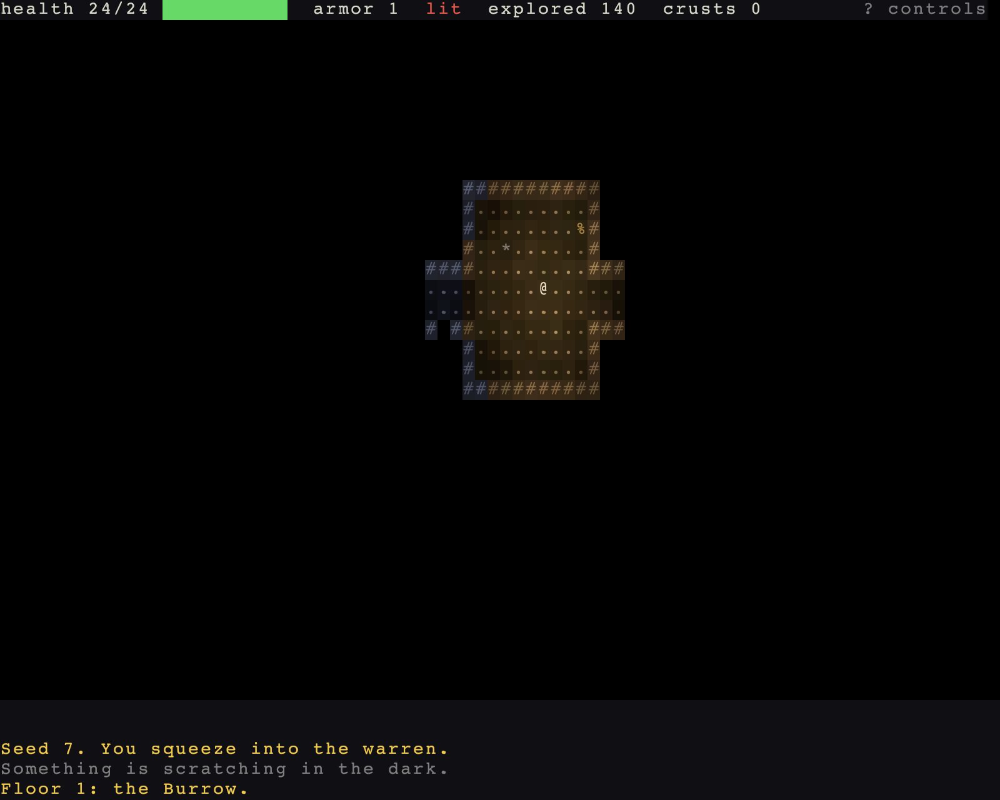

# Floors, and a way out

> Run it: `cargo run -p tutorial --bin step06_descent`
>
> Source: [`step06_descent.rs`](https://github.com/rudehn/rl-engine/blob/main/examples/tutorial/src/bin/step06_descent.rs)

<div class="demo" data-demo="step06_descent">
  
  <button type="button">Play this step</button>
  <p class="weight">Loads about 8 MB</p>
</div>

The warren gets four floors with stairs between them, and a crack of daylight at the bottom that wins the run.

## Floors are maps

<!-- include: ../../../examples/tutorial/src/bin/step06_descent.rs:floors -->
```rust,no_run
/// How deep the warren goes.
const FLOORS: u32 = 4;

/// Floor `n` is map `n`.
fn map_of(floor: u32) -> MapId {
    MapId(floor)
}

/// The floor a map is.
fn floor_of(map: MapId) -> u32 {
    map.0
}

/// What a floor is called.
fn name_of(floor: u32) -> &'static str {
    match floor {
        1 => "the Burrow",
        2 => "the Middens",
        3 => "the Bone Nest",
        _ => "the King's Chamber",
    }
}
```

Each floor is a map with its own `MapId`.
These helpers keep the numbering in one place.

## Building each floor

<!-- include: ../../../examples/tutorial/src/bin/step06_descent.rs:rules -->
```rust,no_run
/// How a floor is built. The engine calls this the first time something
/// enters the floor, with that floor's own seed, and keeps the result.
impl PlaceRules for Floors {
    fn build(&self, map: MapId, seed: PlaceSeed) -> Result<PlaceBuild, BuildError> {
        let (wall, floor) = (self.tiles.expect("earth"), self.tiles.expect("dirt"));
        let mut ctx = BaseContext::blank(84, 42, self.tiles.clone(), wall);
        let chain = match floor_of(map) {
            // Dug rooms near the surface.
            1 | 2 => Chain::new()
                .then(dungeon::Rooms { floor, attempts: 40, min_size: 5, max_size: 10, min_rooms: 6 })
                .then(dungeon::Doors { door: self.tiles.expect("roots") }),
            // Gnawed-out caves below them.
            3 => Chain::new().then(passes::CellularCave { wall, floor, fill_pct: 45, ..Default::default() }).then(passes::KeepLargestRegion { wall }),
            // One wide chamber at the bottom.
            _ => Chain::new().then(dungeon::Rooms { floor, attempts: 60, min_size: 12, max_size: 18, min_rooms: 2 }),
        };
        // A start, and the point farthest from it: where the stairs down go.
        chain.then(dungeon::RandomStart).then(dungeon::FarthestExit).run(&mut ctx, seed)?;
        PlaceBuild::from_context(ctx)
    }

    fn tiles(&self) -> TileTables {
        self.tiles.tables()
    }

    /// The floors, top first, and how their stairs look. The engine lays a
    /// stair up at each floor's start and a stair down at its far point.
    /// The last floor's far point is the game's: the way out.
    fn ladder(&self) -> Option<Ladder> {
        let stone = Rgb::new(204, 204, 219);
        let (up, down) = (StairLook::new('<', stone, "stairs up"), StairLook::new('>', stone, "stairs down"));
        Some(Ladder::new((1..=FLOORS).map(map_of), up, down).bottom(LadderEnd::Game))
    }
}
```

`build` now picks a chain by floor: rooms near the top, caves below, one big chamber at the bottom.
`FarthestExit` marks the cell farthest from the start.

`ladder` tells the engine the floors' order.
It lays a stair down at each floor's far point and a stair up at each start.
`LadderEnd::Game` leaves the last floor's far point to the game.
Each floor is built the first time you enter it, from its own seed, and kept.

`go_through`, in `declare_controls`, adds the stair key `>` to the standard keys.

## The way out

<!-- include: ../../../examples/tutorial/src/bin/step06_descent.rs:populate -->
```rust,no_run
/// The random stream rats are placed from. Each floor draws it from its own
/// seed, so floors can be entered in any order.
const RATS: SeedDomain = SeedDomain::new(b"warren.rats");

/// Fills a floor the first time it is entered.
fn populate(
    mut commands: Commands,
    mut entered: MessageReader<PlaceEntered>,
    rats: Res<Rats>,
    map: Res<WorldMap>,
    seed: Res<Seed>,
    mut tell: MessageWriter<Tell>,
) {
    for ev in entered.read() {
        let depth = floor_of(ev.map);
        tell.write(Tell::new(format!("Floor {depth}: {}.", name_of(depth)), Tones::NOTICE));
        if !ev.first {
            continue;
        }
        // The stairs are the engine's. The way out, at the last floor's far
        // point, is an entity the game spawns.
        if let Some(far) = ev.exit.filter(|_| depth == FLOORS) {
            commands.spawn((Position(far), WayOut, Name::new("crack of daylight"), Glyph::new('<', Color::srgb(1.0, 0.95, 0.70)).on_layer(1)));
        }
        let Some(place) = map.place(ev.map) else { continue };
        let bounds = place.terrain.bounds();
        let mut rng = seed.place(ev.map).rng(RATS, 0);
        let mut placed = 0;
        while placed < 16 {
            let p = Point::new(rng.random_range(bounds.x..bounds.right()), rng.random_range(bounds.y..bounds.bottom()));
            // On floor, and not close enough to the start to be unfair.
            if !map.is_walkable(p) || geometry::chebyshev(p, ev.entry) < 8 {
                continue;
            }
            // Every fourth is a ratling: the same body, a cleverer mind.
            let clever = placed % 4 == 3;
            // A ratling carries its supper, and knows how to eat it.
            let supper = clever.then(|| commands.spawn((Item, Crust(6), Tagged(vec![rats.bread]), Name::new("crust of bread"))).id());
            let mut rat = commands.spawn((
                (Actor, Blocks, Position(p), Speed(110), Faction(rats.faction)),
                (Health::full(6), Armor(0), Perception(7), DarkSight(9)),
                (MeleeAttack::new(rats.bite, DiceRoll::new(1, 3)),),
            ));
            if clever {
                rat.insert((
                    Mind(rats.ratling.clone()),
                    // Wits say what a mind may consider: a ratling opens
                    // doors, picks things up and throws them.
                    Intelligence(Wits::SAPIENT),
                    Inventory { items: supper.into_iter().collect() },
                    Grants(vec![rats.gnaw]),
                    Glyph::new('R', Color::srgb(0.85, 0.66, 0.50)).on_layer(5),
                    Name::new("ratling"),
                ));
            } else {
                rat.insert((Mind(rats.mind.clone()), Intelligence(Wits::ANIMAL), Glyph::new('r', Color::srgb(0.72, 0.55, 0.45)).on_layer(5), Name::new("rat")));
            }
            placed += 1;
        }
        // Bread and rocks, scattered the same way.
        let mut dropped = 0;
        while dropped < 14 {
            let p = Point::new(rng.random_range(bounds.x..bounds.right()), rng.random_range(bounds.y..bounds.bottom()));
            if map.is_walkable(p) {
                litter(&mut commands, &rats, p, dropped % 2 == 0);
                dropped += 1;
            }
        }
    }
}
```

`populate` now names the floor in the log each time you arrive.
On the first visit to the last floor, it spawns the crack of daylight at the far point.

<!-- include: ../../../examples/tutorial/src/bin/step06_descent.rs:way_out -->
```rust,no_run
/// The crack of daylight on the last floor.
#[derive(Component, Clone, Copy)]
struct WayOut;

/// Standing on the daylight wins the run, on the step that reached it.
fn leave(player: Query<(&Position, &OnMap), With<Player>>, ways: Query<(&Position, &OnMap), With<WayOut>>, mut over: MessageWriter<RunOver>) {
    let Ok((at, on)) = player.single() else { return };
    if ways.iter().any(|(way, way_on)| way.0 == at.0 && way_on.0 == on.0) {
        over.write(RunOver::won().saying("You come up into the roots, and the scratching stays below."));
    }
}
```

Winning is a component and an `if`.
`RunOver::won()` ends the run, and the menu opens with your words.

## Try it

- Set `FLOORS` to `2`.
- Swap the chains so the caves are on top.

Next: [content in files](07-content-in-files.md).
