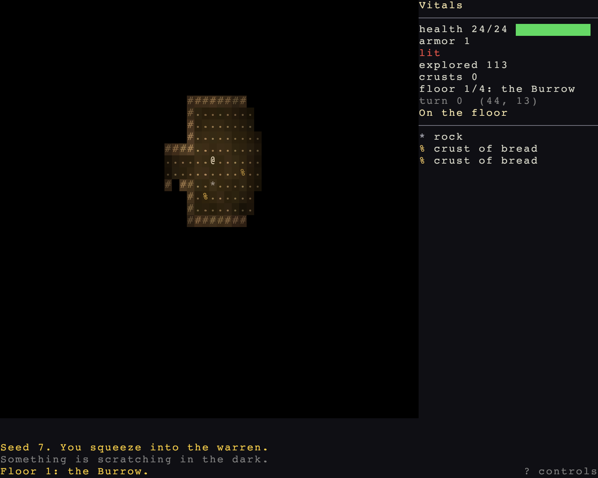

# Panels, and where to go next

> Run it: `cargo run -p tutorial --bin step09_panels`
>
> Source: [`step09_panels.rs`](https://github.com/rudehn/rl-engine/blob/main/examples/tutorial/src/bin/step09_panels.rs)



The status row becomes a rail down the right side: your vitals, then everything in sight.
`x` looks at things, `p` reads the whole log, and `?` lists every key.

## The screen

<!-- include: ../../../examples/tutorial/src/bin/step09_panels.rs:layout -->
```rust,no_run
/// The screen, cut once so the map and every panel agree on it: the map,
/// the log under it, a rail down the right, and boxes over the map.
struct Screen {
    map: GridRect,
    log: GridRect,
    vitals: GridRect,
    nearby: GridRect,
    over_map: GridRect,
    scrollback: GridRect,
    controls: GridRect,
    hint: GridRect,
}

impl Screen {
    fn new() -> Self {
        // Vitals at the head of the rail, the hint for the controls screen
        // in its last row, and what is in sight between them.
        let rail = RailLayout::new(COLS, ROWS, RAIL).log(LOG_ROWS).vitals(9).hint().cut();
        let map = rail.map;
        let over_map = GridRect::new(map.x + 2, map.bottom() - 10, map.width.min(46), 9);
        Self {
            map,
            log: rail.log,
            vitals: rail.vitals,
            nearby: rail.nearby,
            over_map,
            scrollback: map.inflate(-2),
            controls: GridRect::new(0, 0, COLS, ROWS - LOG_ROWS),
            hint: rail.hint,
        }
    }
}
```

`RailLayout` cuts the usual roguelike screen from a few numbers: the map, the log under it, and a rail down the right.
Cutting it once keeps the map and every panel in agreement.

## The panels

<!-- include: ../../../examples/tutorial/src/bin/step09_panels.rs:main -->
```rust,no_run
fn main() -> AppExit {
    let screen = Screen::new();
    let seed = std::env::var("WARREN_SEED").ok().and_then(|s| s.parse().ok()).unwrap_or(7);
    App::new()
        .add_plugins(RoguelikePlugins::new("Warren", COLS, ROWS).map(screen.map))
        .add_plugins(Warren)
        // Each panel draws a view the engine keeps current, in its own
        // rectangle. Add the ones your game has a use for.
        .add_plugins((
            VitalsPanel::new(screen.vitals).heading("Vitals").bars(10),
            NearbyPanel::new(screen.nearby).titled("").headings("In sight", "On the floor"),
            LogPanel::new(screen.log),
            // `x` opens the look cursor; this says what it is on.
            InspectPanel::new(screen.over_map),
            // `p` opens the whole log, scrollable.
            ScrollbackPanel::new(screen.scrollback),
            // `?` lists every key, and the rail's last row says so.
            ControlsPanel::new(screen.controls).hint(screen.hint),
        ))
        .add_plugins(TargetPanel::new(screen.over_map).hints("enter confirm  tab next  esc cancel"))
        .add_plugins(narrator())
        // Escape opens the menu, and dying opens it by itself.
        .add_plugins(GameMenuPanel::new(GridRect::new(COLS / 2 - 20, 8, 40, 12)).died("The warren keeps you."))
        .insert_resource(Seed(RunSeed(seed)))
        .run()
}
```

Each panel reads a view the engine keeps current, and draws itself in its rectangle.

- `NearbyPanel` lists what is in sight, and what is on the floor.
- `InspectPanel` says what the look cursor (`x`) is on, and forecasts a fight with it.
- `ScrollbackPanel` shows the whole log on `p`, scrollable and filterable.

## A note of your own

The engine doesn't know that a hurt rat is fleeing; that's Warren's rule.
The game adds a `Facet` to the rat's row, in a tone it declares:

<!-- include: ../../../examples/tutorial/src/bin/step09_panels.rs:tone -->
```rust,no_run
        // A tone the engine never heard of, for a note on the nearby list.
        app.add_tone("fleeing", Color::srgb(0.6, 0.8, 1.0));
        app.add_plugins(NearbyViewPlugin).add_systems(Update, (note_floor, note_what_a_rat_is_doing).in_set(ViewSet::Annotate));
```

<!-- include: ../../../examples/tutorial/src/bin/step09_panels.rs:annotate -->
```rust,no_run
/// The rail has room for which floor this is.
fn note_floor(mut vitals: ResMut<VitalsView>, map: Res<WorldMap>) {
    let depth = floor_of(map.current());
    vitals.facets.push(Facet::new("floor", format!("floor {depth}/{FLOORS}: {}", name_of(depth))));
}

/// What a rat is up to, as a note on its row in the nearby list. Fleeing
/// is this game's rule, so the engine prints the note without knowing it.
fn note_what_a_rat_is_doing(mut nearby: ResMut<NearbyView>, tones: Res<Tones>, bestiary: Res<Bestiary>, rats: Query<(&Kind, &Health)>) {
    let fleeing = tones.get("fleeing").expect("declared in Warren");
    for row in nearby.actors.iter_mut() {
        let Ok((kind, health)) = rats.get(row.entity) else { continue };
        if health.current * 100 <= bestiary.defs.get(kind.0).flee_at * health.max {
            row.facets.push(Facet::new("mood", "fleeing").toned(fleeing));
        }
    }
}
```

`Kind` on each creature lets the system look up its definition's `flee_at`.

## Testing without a window

<!-- include: ../../../examples/tutorial/src/bin/step09_panels.rs:headless -->
```rust,no_run
    fn started(seed: u64) -> (App, Entity) {
        let mut app = headless(RunSeed(seed), narrator(), (Warren, KeyScriptPlugin));
        let me = player(&mut app);
        (app, me)
    }
```

`atglyph::testing::headless` is the engine with no window, plus the narrator and the game plugin `main` adds.
`KeyScriptPlugin` lets a test press keys through the real input path.
The test module of each step is a worked example.

## Where to go next

Each system has a reference page.
These are the ones Warren didn't use:

| System | What it adds |
|---|---|
| [Stealth](systems/stealth.md) | Monsters that haven't noticed you yet, and sneaking past them |
| [Statuses](systems/statuses.md) | Poison, sleep, and anything else with a duration |
| [Items](systems/items.md) and [uses](systems/uses.md) | Equipment slots, worn bonuses, and things used from the bag |
| [Ammunition](systems/ammunition.md) | Guns, bows and what they fire |
| [Loot](systems/loot.md) | What a floor and a container hold, drawn from tables |
| [Props](systems/props.md) | Crates, levers, traps and containers |
| [Fields](systems/fields.md) | Fire and gas that spread from cell to cell |
| [Work](systems/work.md) | Actions that take many turns |
| [Trade](systems/trade.md) | Buying and selling between two actors |
| [Saving](systems/saving.md) | Saving and continuing a run |
| [Title](systems/title.md) | A title screen with New Game and Continue |
| [Records](systems/records.md) | A high-score table of past runs |
| [Panels](systems/panels.md) | The rest of the panels: gear, the bag, a character sheet |
| [Controls](systems/controls.md) | Rebinding and grouping keys |

To play [in a text terminal](systems/tty.md), locally or over SSH, add `TtyRoguelikePlugins::new(cols, rows)` in place of `RoguelikePlugins`.
The starter template does this with `--tty`.

## The crates

| Tier | Crates | Bevy |
|---|---|---|
| 0 | `atglyph-core` | no |
| 1 | `atglyph-grid`, `atglyph-mapgen`, `atglyph-rules` | no |
| 2 | `atglyph-bevy`, `atglyph-render`, `atglyph-ui`, `atglyph-save`, `atglyph-tty` | yes |
| 3 | `atglyph` | facade |

Map generation, field of view, pathfinding, damage and the AI brains are tier 1.
They run and test without Bevy, and a tool can depend on one of them alone.

## Further reading

- Two whole games built on the engine: [Undermere](https://github.com/rudehn/undermere) and [Foundry](https://github.com/rudehn/foundry).
- [`docs/OVERVIEW.md`](https://github.com/rudehn/rl-engine/blob/main/docs/OVERVIEW.md), everything the engine has.
- [`docs/design/`](https://github.com/rudehn/rl-engine/tree/main/docs/design), how each subsystem works and why.
